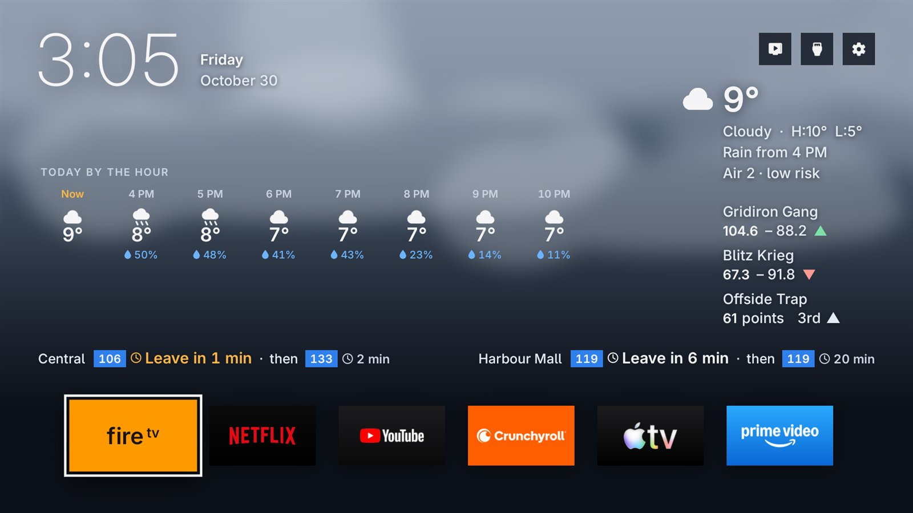
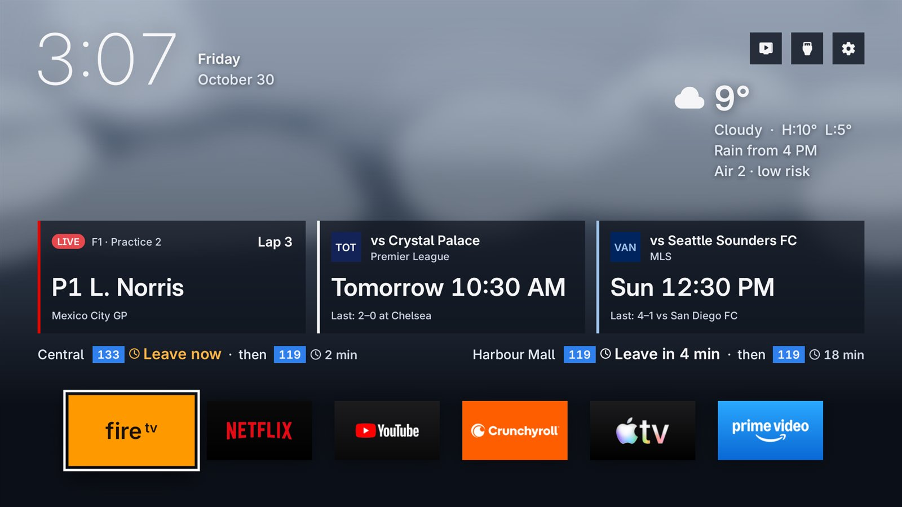
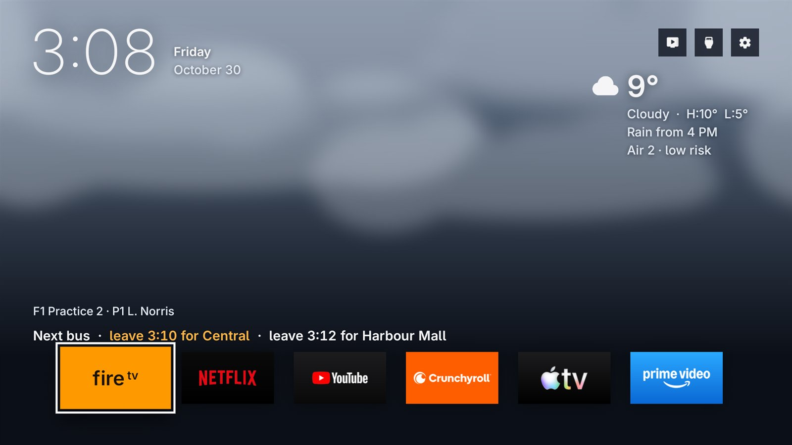
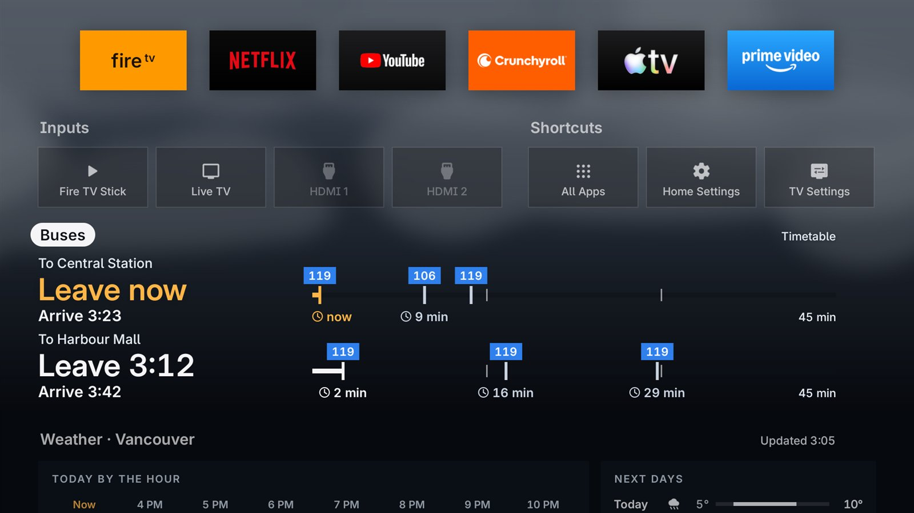
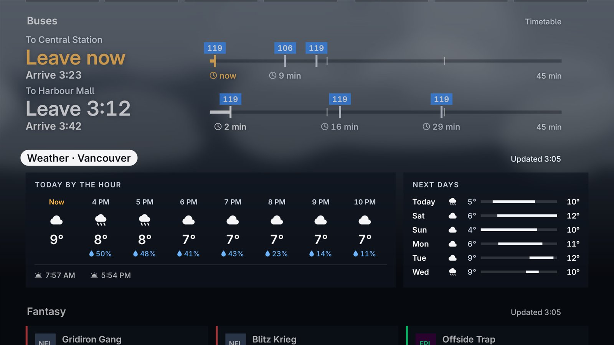
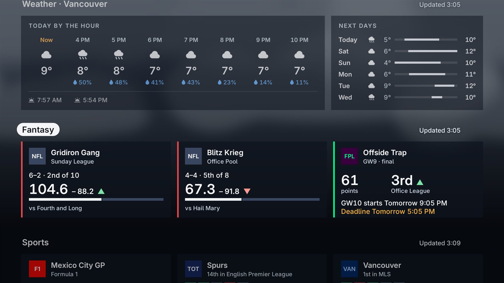
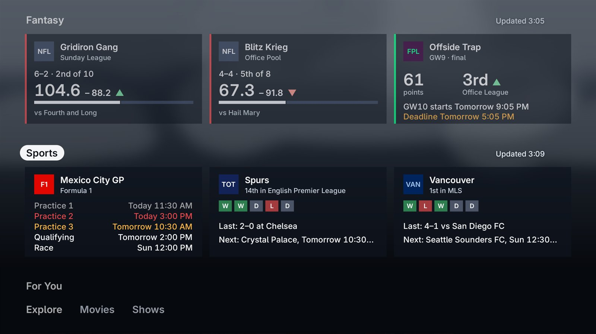
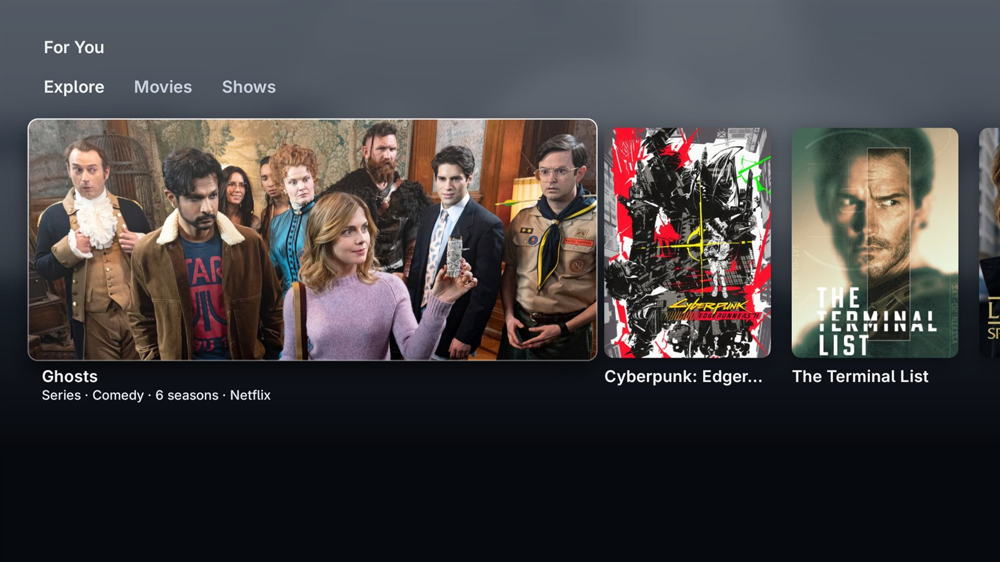

<div align="center">


# 808 TV

**A glance-board home screen for Google TV: buses, weather, sports and fantasy scores, one remote press away.**

A fork of [Free My TV](https://github.com/simbasjungles/free-my-tv). Open source. Built with Claude Code. One button to undo.

[What's new](#whats-new-in-this-fork) · [Data sources](#where-the-data-comes-from) · [Install](#install) · [Privacy](#privacy) · [Credits](#credits)



</div>

> **This is a fork.** It's [PhuruShekar/free-my-tv](https://github.com/PhuruShekar/free-my-tv), a fork of
> [simbasjungles/free-my-tv](https://github.com/simbasjungles/free-my-tv). The base (the installer, the safe switch between
> home screens, the screensaver, the picks and the LG and Samsung apps) is the original author's work, and its README covers
> all of that. This one covers only what the fork adds. Everything here is Google TV only; the LG and Samsung apps are as
> upstream.

## What's new in this fork

808 TV is one person's home screen, on a Google TV, so some of it is tied to where they live (Metro Vancouver buses, an
air-quality station, two football teams). The
screenshots use made-up teams and bus places (`demo=true`, [below](#try-it-without-your-accounts-demo-mode)).

The main screen changes with the hour of the day (the clock, the weather and the bus line stay; the middle changes):

| | |
|---|---|
|  |  |
| **11 am to 4 pm.** The hours of the day in the middle, your fantasy teams under the current weather, the next bus for each place in one line over the shelf. | **Sports on.** While a game or an F1 session is on (or starts soon), cards for it take the middle: live score, or the next kickoff and the last result. |
|  | |
| **9 pm to 6 am.** Quiet hours: the sky stays still, the tiles dim, and one bright line says when to leave for the next bus. | |

In the mornings (6 to 11) and evenings (4 to 9) the bus line becomes a timeline for each place: a mark for every bus on a
45-minute scale, with "Leave 7:49" and "Arrive 7:58" beside it.

Below the shelf and the TV sources, the drawer has one row per widget. Down moves from one row to the next; the row you're on
gets a white pill and the rest fade. Nothing sideways to scroll.

<table>
<tr>
<td width="50%"></td>
<td width="50%"></td>
</tr>
<tr>
<td><b>Buses.</b> Per place: when to leave (the bus time minus your walk), when you'll arrive, and the next three buses on a shared scale. A clock icon means the time comes from the timetable, no clock means live.</td>
<td><b>Weather.</b> Today by the hour (temperature and chance of rain), sunrise and sunset, and the next 5 days as bars from low to high on one scale. The sky behind everything follows it: clear, cloudy, rain, storm or snow, day or night.</td>
</tr>
<tr>
<td></td>
<td></td>
</tr>
<tr>
<td><b>Fantasy.</b> A card per Sleeper team (record, place in the league, this week's score against the opponent's with a bar, last week's result) and a Fantasy Premier League card (gameweek points, your rank in one mini-league with ▲ ▼ =, when the next gameweek starts, and the deadline in amber from 48 hours before).</td>
<td><b>Sports.</b> Your two football teams (standing, last five results as W/D/L, last and next game) and the F1 weekend: the session on in red, the next in amber, the ones run in grey.</td>
</tr>
<tr>
<td colspan="2"><br><b>For You.</b> Upstream's picks, now the last row: Explore, Movies and Shows tabs (Up from the cards focuses them), the focused pick wide and the others as posters.</td>
</tr>
</table>

Also changed: the shelf is centred, the apps' tiles and the cards are square, the first shelf tile is whatever is on HDMI 3
(named and coloured after the device, "fire tv" for a Fire TV Stick), and every on-screen line says 808 TV, with the credit
to Free My TV on the settings screen. English is the only language (the other catalogues were removed, they stay in git history).
The design log, with the owner's decisions and a build log per step, is in [`design/home-redesign.md`](design/home-redesign.md).

### Where the data comes from

Every source below is public. Only the TransLink one needs a key. Nothing is fetched unless the home screen is showing
(the screensaver asks for none of it), and each widget keeps its last good data under an "Updated 3:05" if a fetch fails.

| Widget | Source | How often | What's needed |
|---|---|---|---|
| Weather and sky | [Open-Meteo](https://open-meteo.com): forecast, hourly rain chance, sunrise and sunset | every 30 minutes | `latitude`, `longitude`, `city` |
| Weather alerts, air quality | [Environment Canada](https://api.weather.gc.ca) (no key): alerts at your location, AQHI of one station | every hour | Canada only; the station is `AQHI_STATION` in `HomeData.java` |
| Buses, timetable | A timetable built into the app (`app/assets/buses.txt`), written by [`tools/BusTimetable.java`](tools/BusTimetable.java) from TransLink's static GTFS file for four bus and stop pairs, and the days that run another day's buses | built at build time, valid until the date in its first line | Edit the pairs in the tool for your stops |
| Buses, live | [TransLink](https://www.translink.ca/about-us/doing-business-with-translink/app-developer-resources) GTFS-Realtime (a protobuf, decoded by hand in `Transit`): every trip under way in the region, ~1 MB. A live time replaces its timetable bus; older than 15 minutes counts as gone | every 5 minutes | `translink_key` (free, secret, yours) |
| Sports | ESPN's public site API: each team's page (next game, standing), the league's scoreboard while a game is on, the schedule for the results, and the F1 scoreboard (the whole weekend, with the session on, its lap and the order) | every 30 minutes, every minute while something is on or starts within 15 | Teams are set in `HomeData.TEAMS` (Tottenham, Whitecaps) |
| Fantasy, NFL | [Sleeper](https://docs.sleeper.com)'s public API: your leagues from your username, rosters, and this week's matchups | every 5 minutes (the leagues and names once an hour) | `sleeper_user` |
| Fantasy, football | [Fantasy Premier League](https://fantasy.premierleague.com)'s public (unofficial) API: your entry, its mini-leagues, the gameweeks and fixtures | every 5 minutes (the gameweeks once a day) | `fpl_team` (your team id), `fpl_league` (the mini-league to show) |

The settings go in `config.properties` like upstream's (see [`config.example.properties`](config.example.properties)):

```properties
translink_key=       # buses, live times
sleeper_user=        # fantasy, NFL
fpl_team=            # fantasy, football
fpl_league=          # the mini-league's id
```

Leave one empty and its widget hides (no buses without the timetable and a key, no fantasy row without a Sleeper user or
an FPL team); sports and weather always show. The timetable and the live feed are only read for the places in
`HomeView.BUS_PLACES`.

How the code is split: the plain-Java parts (what a bus time is, which game to show, a fantasy rank's arrow, how many days
the forecast keeps) are in [`Transit`](app/src/io/freemytv/Transit.java), [`Sports`](app/src/io/freemytv/Sports.java),
[`SportsFeed`](app/src/io/freemytv/SportsFeed.java), [`Fantasy`](app/src/io/freemytv/Fantasy.java) and
[`Rules`](app/src/io/freemytv/Rules.java), and `tools/test.sh` checks them on a computer (231 checks, saved ESPN feeds
included). [`HomeData`](app/src/io/freemytv/HomeData.java) fetches and reads the JSON, and
[`HomeView`](app/src/io/freemytv/HomeView.java) draws it all on one Canvas, as upstream does.

### Try it without your accounts (demo mode)

`demo=true` in `config.properties` fills the Fantasy row with made-up teams ("Gridiron Gang", "Offside Trap"…), shows the
timetable's buses (no key needed) under made-up place names, and skips the Sleeper, FPL and TransLink requests. Set `city`,
`latitude` and `longitude` to any city for the weather. It's how the screenshots above were made.

## Install

You need a Google TV or Android TV (Android 8 or newer, tested on a TCL Google TV), a computer on the same Wi-Fi, a JDK 17+,
the Android SDK command-line tools (build-tools 34, platform android-34) and adb. The original's README has the
step-by-step version, including the AI-assistant way; the short one:

1. **On the TV:** Settings → System → About → press *Android TV OS build* 7 times, then Settings → System → Developer
   options → **USB debugging** on. Note the TV's IP address.
2. **Settings:** run `./build.sh` once, which creates `config.properties` from [`config.example.properties`](config.example.properties).
   Fill in your city (`latitude`, `longitude`, `city`), `tmdb_key` (free, for the picks) and the keys of the
   [widgets you want](#where-the-data-comes-from). Never commit this file.
3. **Build and install:**
   ```bash
   ./build.sh
   adb connect 192.168.1.50:5555
   adb install -r FreeMyTV.apk
   ```
   On TCL TVs also let it run in the background (TCL blocks it by default, and the switch never starts), after every install:
   ```bash
   adb shell "appops set io.freemytv AUTO_START allow || appops set io.freemytv APP_AUTO_START allow"
   ```
4. **On the TV:** open the app (808 TV) → *Home Screen* → *808 TV*, and allow USB debugging when asked.

**Going back:** the same row, *Original*, brings back the TV's own home screen and everything the switch turned off. A
watchdog also does it by itself after three crashes in five minutes.

### Remote buttons

*Remote Buttons* in the app's settings sets what each of the remote's app buttons opens, or *Nothing* to leave it to the
TV. On a TCL there are six: Netflix, YouTube, Prime Video, TCL Channel, Apple TV and Pluto TV. Apple TV and Pluto TV start
as *Nothing*. (They work through a small accessibility service that reads only those buttons, which *Original* turns off.)

## Privacy

No accounts, no analytics, no tracking. Nothing is fetched unless the home screen is showing, and your settings stay on your
computer and your TV. The app talks to:

- **Always:** TMDB (the picks) and Open-Meteo (the forecast, with the coordinates you set).
- **Only if you set it up:** TransLink (`translink_key`), Sleeper (`sleeper_user`), Fantasy Premier League (`fpl_team`),
  Binance (`show_crypto=true`), Watchmode, your Plex or Immich server, and Trakt (once you sign in on the TV).
- **Without any setting:** Environment Canada (alerts at your coordinates, one air-quality station) and ESPN (the two teams
  and the F1 weekend in the code).
- **Updates:** a release APK asks GitHub once a week, or when you press *Updates*, for the latest release. A build you made
  yourself asks only when you press *Updates*.

The fantasy and TransLink keys and usernames are in your build only, so anyone who can read the APK on your TV can read them:
the Sleeper and FPL ones are public data anyway; keep the TransLink key to yourself. The upstream README has the rest (the
notification listener behind *Now Playing*, the TMDB key's QR code, Continue Watching).

## Credits

- **[Free My TV](https://github.com/simbasjungles/free-my-tv)** by [simbasjungles](https://github.com/simbasjungles): the base this
  is forked from. MIT licensed.
- Built with [Claude Code](https://claude.com/claude-code).

**Data (the APIs this fork calls):**

- [Open-Meteo](https://open-meteo.com/): forecast, rain chance, sunrise and sunset (CC BY 4.0).
- [Environment Canada](https://api.weather.gc.ca): weather alerts and air quality (AQHI), under the
  [Open Government Licence – Canada](https://eccc-msc.github.io/open-data/licence/readme_en/).
- [TransLink](https://www.translink.ca/about-us/doing-business-with-translink/app-developer-resources): the static timetable
  (GTFS) and the real-time feed (GTFS-Realtime). Contains information licensed under TransLink's open data terms.
- [ESPN](https://www.espn.com): scoreboards, standings and the F1 weekend, from its public site API (unofficial, can change).
- [Sleeper](https://docs.sleeper.com): NFL fantasy leagues, rosters and matchups.
- [Fantasy Premier League](https://fantasy.premierleague.com): gameweeks, fixtures and mini-league ranks (unofficial API).
- [TMDB](https://www.themoviedb.org/): the picks. This product uses the TMDB API but is not endorsed or certified by TMDB.
- Optional, from upstream: [Watchmode](https://api.watchmode.com/), [Binance](https://www.binance.com/), Plex, Immich and Trakt.

Icons: [Material Symbols](https://fonts.google.com/icons) (Apache 2.0). Font: [Inter](https://rsms.me/inter/) (SIL OFL 1.1).
The QR code encoder follows Project Nayuki's [QR Code generator](https://www.nayuki.io/page/qr-code-generator-library) (MIT).
Not affiliated with Google, TCL, ESPN, TransLink, Sleeper, the Premier League or any streaming service. Names and logos belong
to their owners.

## License

[MIT](LICENSE). Fork it, change it, ship it.
